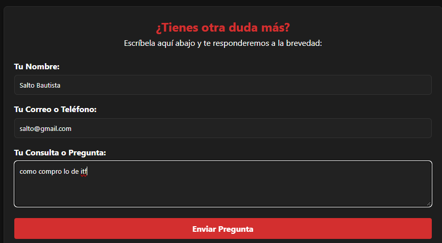
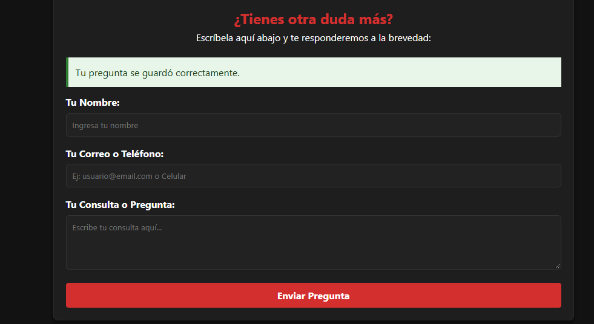
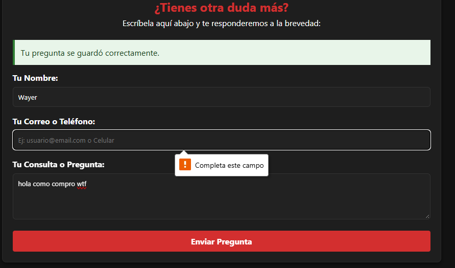
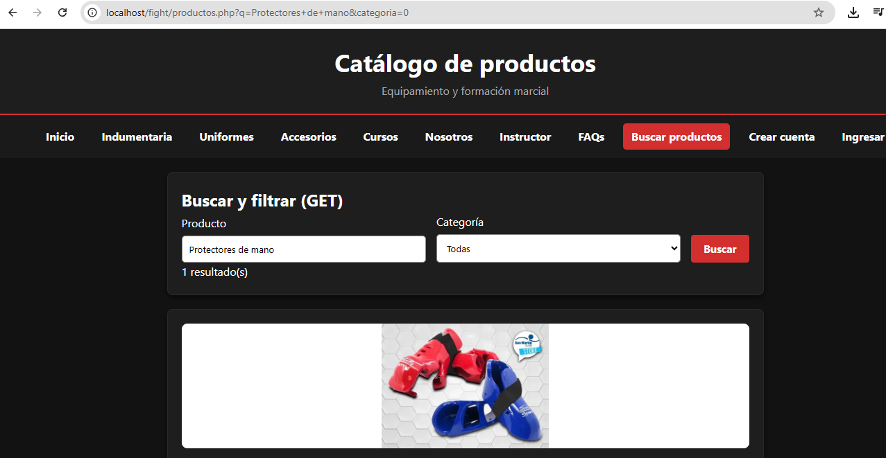

# TP5 — Formularios GET y POST, validaciones y XSS

**Proyecto:** Lunar MCA / Impact Fight  
**Materia:** Programación Web

## Objetivo del trabajo

Recibir información enviada desde el navegador con `POST` y realizar búsquedas con `GET`. Comprobar campos, controlar errores y mostrar los datos sin interpretar entradas de usuarios como código HTML.

## Desarrollo observado

La sección de consultas del sitio incorpora un formulario para ingresar un nombre, un correo o teléfono y una pregunta. Las evidencias muestran el formulario, un mensaje de que la pregunta se guardó correctamente y una comprobación de campo obligatorio mediante el navegador.

También existe una búsqueda de productos que usa parámetros GET: la captura muestra un filtro en el catálogo y un resultado. Para prevenir XSS, la aplicación PHP debe validar y normalizar las entradas (por ejemplo `trim()` y `filter_var()` cuando corresponda) y escapar la salida con `htmlspecialchars()`.

> La imagen de validación todavía muestra un aviso de éxito anterior en la parte superior; sirve para evidenciar el campo obligatorio, pero conviene repetir esa prueba en un formulario limpio, sin el mensaje de éxito previo. Esa imagen no demuestra por sí sola la validación del lado del servidor.

## Evidencias del TP5

**1. Formulario de consultas antes del envío.**

**2. Confirmación visual del envío.**

**3. Comprobación de campo obligatorio en el navegador.**

**4. Búsqueda GET desde el catálogo.**

## Qué probar para la demostración

1. Enviar una pregunta de prueba con todos los campos válidos y verificar el resultado.
2. Repetir el envío con algún campo vacío y comprobar que no se procesa el formulario y que se conserva el contenido válido.
3. Buscar un producto y revisar el parámetro GET en la URL.
4. Comprobar también la validación **en PHP** y el escape de datos al mostrarlos.

## Conclusión

El uso de POST permite enviar consultas y GET facilita filtrar productos. Validar entradas y escapar los valores al mostrarlos son medidas necesarias para evitar datos inválidos y vulnerabilidades XSS.
